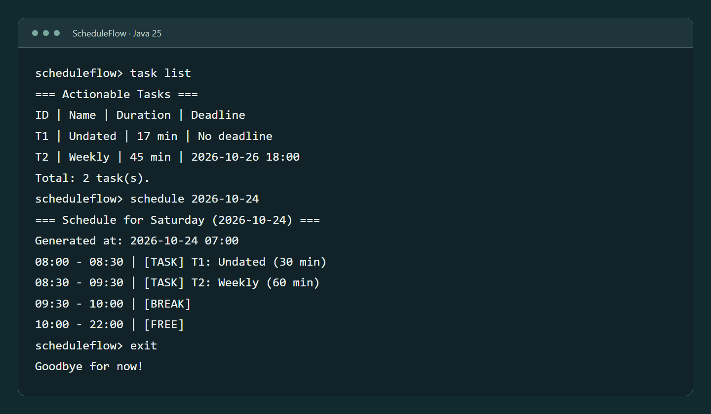

<!-- @@author ernestgoh-god -->
<link rel="stylesheet" href="assets/css/home.css">
<link rel="stylesheet" href="{{ '/assets/css/navigation.css' | relative_url }}">

  

  <main>
    <h1>ScheduleFlow</h1>

    <figure class="sf-preview">
      
      <figcaption>An example saved schedule. Select the image to view it at full size.</figcaption>
    </figure>

    
<strong>ScheduleFlow is a command-line application for university students planning coursework around classes and other commitments.</strong> Track remaining work, record progress, and generate study schedules before your deadlines. Successful changes and generated plans save automatically on your computer.

    <ul>
      <li>To start using ScheduleFlow, follow the <a href="QuickStart.html"><strong>Quick start</strong></a>. You will need Java 25.</li>
      <li>For commands, examples, and troubleshooting, see the <a href="UserGuide.html"><strong>User Guide</strong></a>.</li>
      <li>To develop ScheduleFlow, start with the <a href="DeveloperGuide.html"><strong>Developer Guide</strong></a>.</li>
    </ul>

    <section class="sf-acknowledgements" aria-labelledby="sf-acknowledgements-title">
      <h2 id="sf-acknowledgements-title">Acknowledgements</h2>
      <ul>
        <li>Project starter: <a href="https://github.com/NUS-CS2113-AY2627-S1/tp">CS2113 Duke template</a>.</li>
        <li>Homepage layout inspired by <a href="https://se-education.org/addressbook-level3/">AddressBook Level 3</a>.</li>
        <li>Testing framework: <a href="https://junit.org/junit5/">JUnit 5</a>. See the <a href="DeveloperGuide.html#acknowledgements">Developer Guide</a> for full acknowledgements.</li>
      </ul>
    </section>
  </main>

<!-- @@author -->
